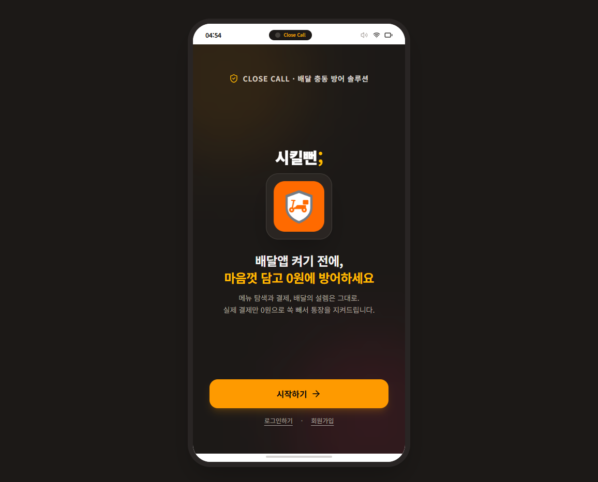
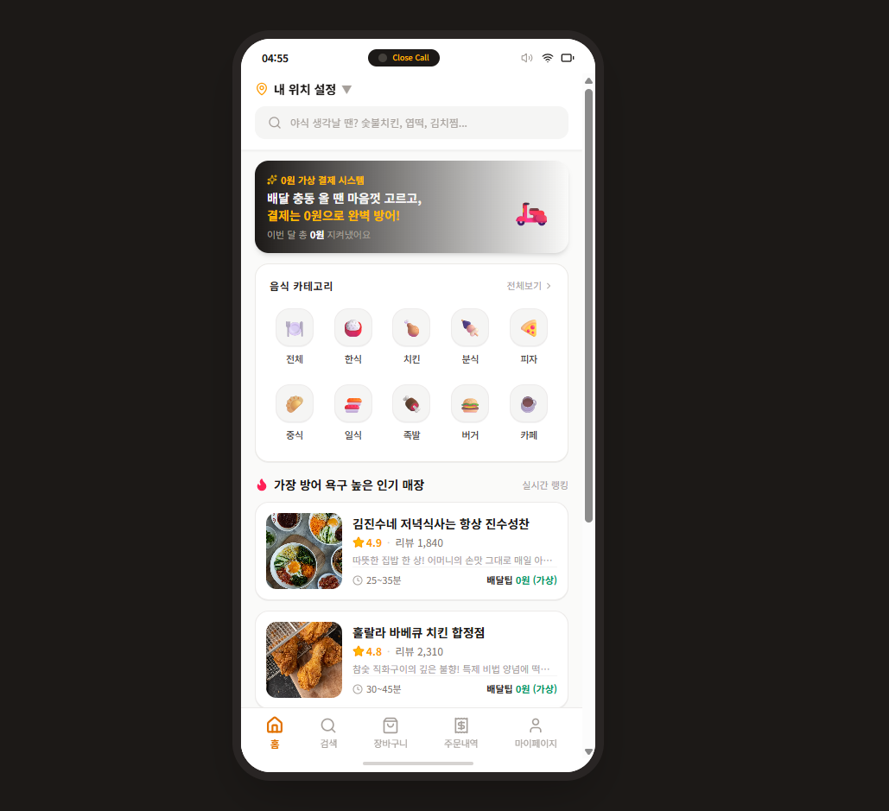

# 🛵 시킬뻔 (Close Call)

> **"주문하는 손맛은 그대로, 지갑과 야식 방어는 확실하게."**  
> 밤마다 찾아오는 충동적인 야식 유혹을 가짜 주문·0원 결제·배달 시뮬레이션의 '손맛과 도파민'으로 방어하는 1인 개발 모바일 반응형 웹 애플리케이션입니다.

🔗 **배포 링크:** [시킬뻔 바로가기(https://close-call-three.vercel.app)] 
*(※ 모바일 웹 뷰에 최적화되어 있으며, PC 접속 시 스마트폰 프레임으로 렌더링됩니다.)*

---

## 📸 프로젝트 미리보기

| 초기 진입 화면 (Splash) | 가짜 배달 홈 화면 (Home) |
| :---: | :---: |
|  |  |

---

## 🎯 기획 배경 및 핵심 가치 (Why Close Call?)

* **문제 인식:** 많은 다이어터와 1인 가구가 늦은 밤 배달 앱을 켜고 메뉴를 탐색하다 충동 결제로 이어지는 '야식 딜레마'를 겪습니다.
* **해결 방식:** 단순 가계부나 텍스트 기록 방식은 배달 앱 특유의 도파민을 채워주지 못합니다. "시킬뻔"은 실제 배달 앱을 99% 모방한 UI에서 **메뉴 탐색 ➔ 옵션 선택 ➔ 0원 가상 결제 ➔ 가상 라이더 트래킹**까지 진행하여 뇌에 시각적 대리만족(손맛)을 제공하고 주문 충동을 자연스럽게 해소합니다.
* **성취감 제공:** 배달 시뮬레이션 완료 시점에 비로소 '방어 성공'으로 판정되어 절약한 금액과 방어 횟수가 누적 리포트로 시각화됩니다.

---

## ✨ 핵심 기능

1. **배달 앱 UI/UX 모방 및 탐색**
   - 10종 음식 카테고리별 매장 조회 및 상세 메뉴/옵션 바텀시트 제공
   - 실제 배달 앱과 동일한 장바구니 담기 및 동적 금액 계산
2. **0원 가상 결제 시스템**
   - 실제 비용 청구 없이 결제 완료의 쾌감을 제공하는 가상 결제 프로세스
3. **타이머 기반 가상 배달 시뮬레이션**
   - 주문 접수 ➔ 조리 중 ➔ 배달 중 단계별 실시간 상태 전이
   - 결제 직후의 도파민 피크를 안전하게 진정시키는 단계별 인터랙션
4. **배달 방어 성취 리포트 (마이페이지)**
   - 배달 완료 시점에만 방어 영수증 데이터 적재
   - 총 세이브(절약) 금액 합산 및 차트 기반 방어 통계 시각화
5. **사용자 관리 및 접근 제어**
   - Supabase Auth 기반 회원가입/로그인
   - 비로그인 유저의 둘러보기는 허용하되 장바구니/주문/마이페이지/주소변경 시 로그인 유도
   - 마이페이지 주소 변경(DB 영구 저장)과 홈/결제창 주소 변경(임시 배달지 갱신)의 상태 분리

---

## 🛠 기술 스택

### Frontend
- **Language & Core:**  TypeScript, React 19, Vite
- **Styling:** Tailwind CSS
- **State Management:** React Context API (카탈로그, 장바구니, 주문 시뮬레이션 전역 관리)
- **Motion & UI Effects:** Motion (애니메이션), Canvas Confetti (축하 효과), Lucide React (아이콘)

### Backend & Database (BaaS)
- **BaaS & DB:** Supabase (Authentication, PostgreSQL Database)
- **Security:** PostgreSQL Row Level Security (RLS) 데이터 접근 제어

### Tools & Design
- **Design:** Figma (와이어프레임 및 화면 설계)
- **IDE & Development:** Anti-gravity IDE, Git, GitHub
- **Deployment:** Vercel
---

## 🏛 아키텍처 결정

### 1. 주문 데이터 단일화 영수증 테이블 구조 (`close_call_orders`)
* **배경:** 일반 이커머스는 `orders`와 `order_items` 다중 테이블로 정규화하지만, 본 서비스의 핵심 지표는 '방어 성공 횟수 누적'과 '세이브 금액 합산'입니다.
* **결정:** 장바구니에서 선택된 메뉴와 다중 옵션들을 프론트엔드에서 `.join(' / ')` 형태의 단일 문자열(`option_text`)로 결합해 `close_call_orders` 테이블에 1회 INSERT하는 단일 영수증 구조를 채택했습니다.
* **효과:** 불필요한 다중 INSERT 트랜잭션 에러 위험과 테이블 조인 오버헤드를 원천 차단하고, 1인 개발 환경에서 빠른 렌더링 성능과 데이터 단순성을 확보했습니다.
### 2. DB 트리거를 활용한 사용자 프로필 자동 동기화
* **결정:** 프론트엔드에서 회원가입 후 `users` 테이블에 별도 INSERT를 호출하지 않고, PostgreSQL의 `AFTER INSERT ON auth.users` 트리거 함수(`handle_new_user`)를 통해 프로필 레코드가 원자적(Atomic)으로 생성되도록 설계했습니다.
* **효과:** 네트워크 불안정으로 인한 Auth 계정과 Profile 데이터 간의 불일치 위험을 완전히 방지했습니다.

---

## 🗄 데이터베이스 구조

Supabase PostgreSQL 기반의 4개 핵심 테이블로 구성되어 있습니다.

* **`users`**: 유저 고유 UUID (auth.users FK), 이메일, 닉네임, 연락처, 기본 배달 주소
* **`stores`**: 가상 음식점 상호명, 카테고리, 평점, 배달팁, 썸네일 URL, 리뷰 수, 배달 예상 시간, 태그
* **`menus`**: 음식점별 메뉴명, 가격, 메뉴 설명, 이미지 URL
* **`close_call_orders`**: 방어 성공 영수증 (참아낸 음식명, 옵션 텍스트, 세이브 금액, 방어 일시)

---

## 🔧 문제 해결 및 트러블슈팅 (Troubleshooting)

### 1. 배달 완료 시점의 영수증 중복 INSERT 방어
- **문제**: React 19 환경 및 타이머 종료 시점의 비동기 호출 처리 중, 동일 주문 건에 대해 방어 완료 이벤트가 중복 호출되어 DB에 영수증이 2회 적재될 위험이 발생했습니다.
- **해결**: `completeDefense(orderId)` 단일 진입 함수에 `useRef` 기반의 1회성 실행 가드(Guard Lock)를 구현하여, 한 번 완료 처리된 주문 건은 재호출되지 않도록 원천 차단했습니다.

### 2. Supabase 403 Forbidden 권한 에러 및 RLS 정책 수립
- **문제**: 프론트엔드에서 정상적으로 결제 및 방어 완료를 진행했음에도 불구하고, Supabase 통신 시 `permission denied for table close_call_orders (403)` 에러가 발생하며 데이터가 적재되지 않았습니다.
- **해결**: PostgreSQL의 Row Level Security(RLS) 정책이 기본 차단되어 있던 원인을 규명하고, `auth.uid() = user_id` 조건의 INSERT/SELECT 정책을 정밀하게 부여하여 본인의 방어 이력만 안전하게 읽고 쓸 수 있도록 보안 접근 제어를 완성했습니다.

### 3. 타이머 및 오디오 리소스 메모리 누수 방지
- **문제**: 가상 배달 단계 및 축하 모달에서 `setTimeout`과 `AudioContext` 인스턴스가 컴포넌트 언마운트 시점에 정리되지 않아 브라우저 오디오 리소스 한도 경고가 발생했습니다.
- **해결**: 사운드 재생 로직을 싱글톤 유틸(`utils/sound.ts`)로 일원화하고, 모든 타이머 인터랙션에 `useEffect cleanup` 함수를 명시적으로 작성하여 언마운트 시 리소스가 완벽히 해제되도록 최적화했습니다.
